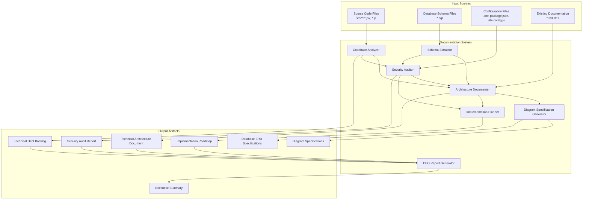
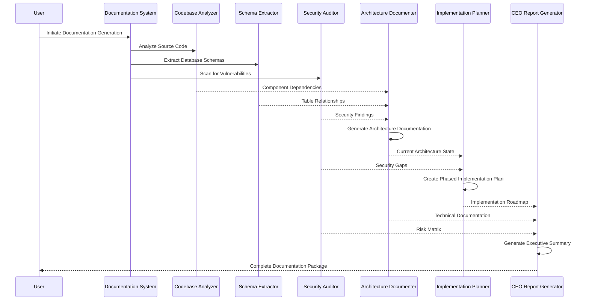
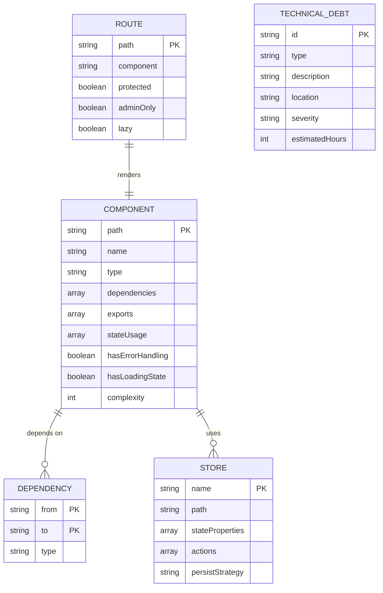
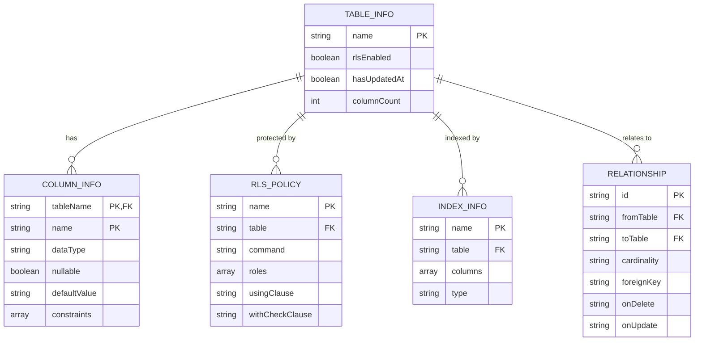
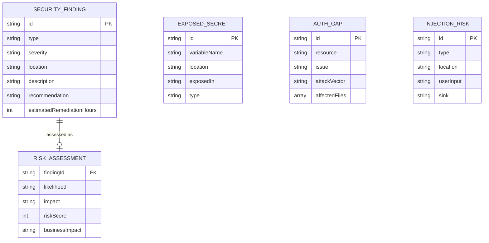
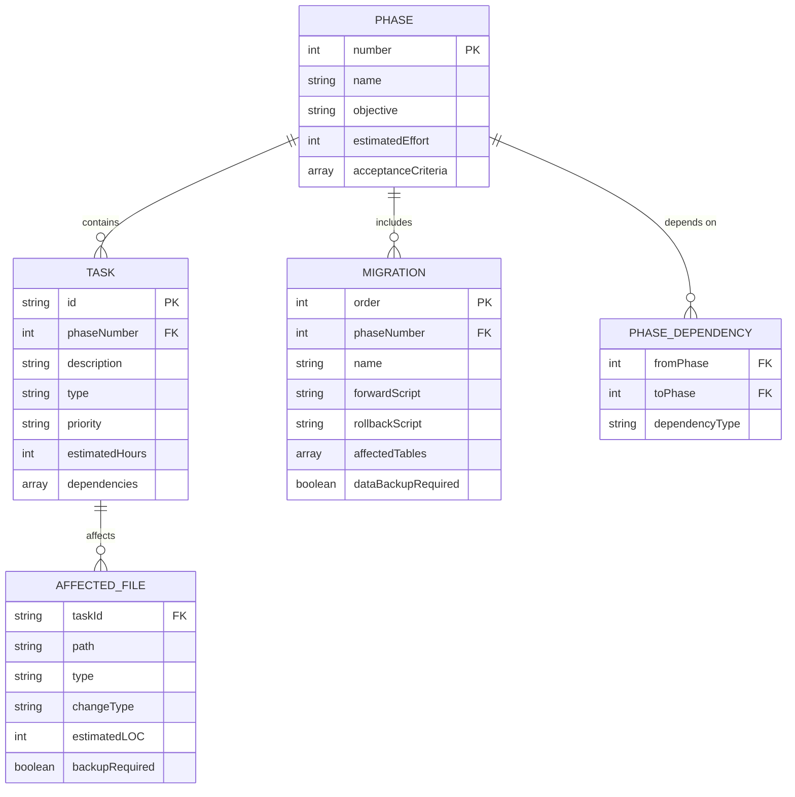
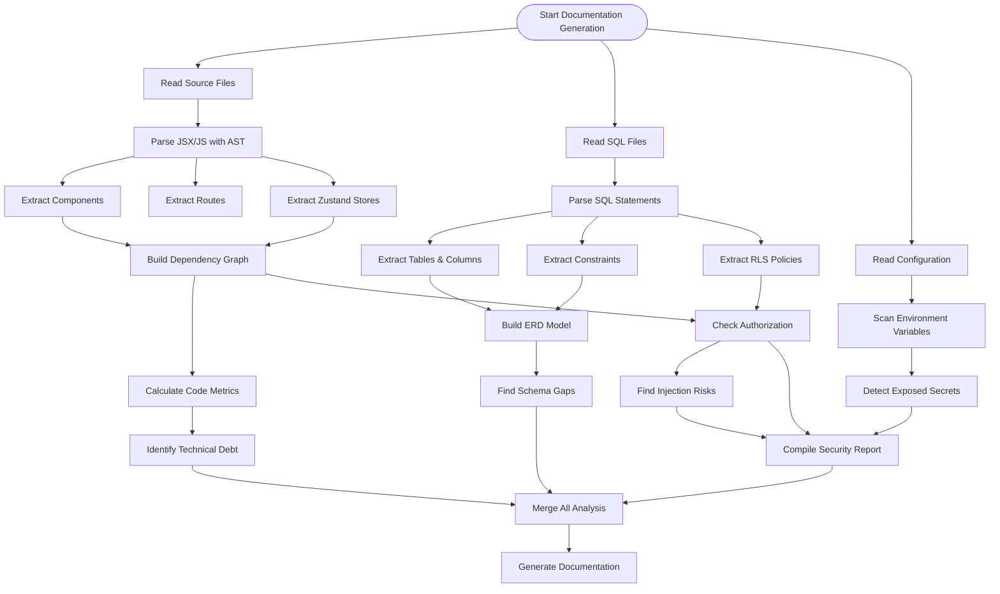
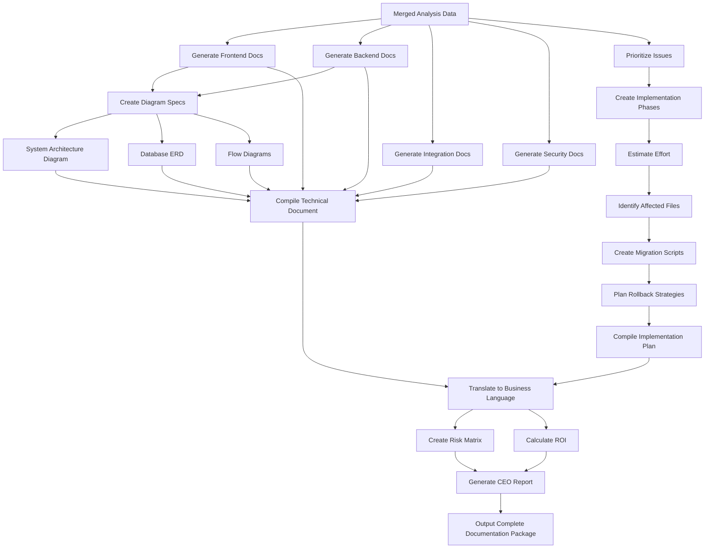
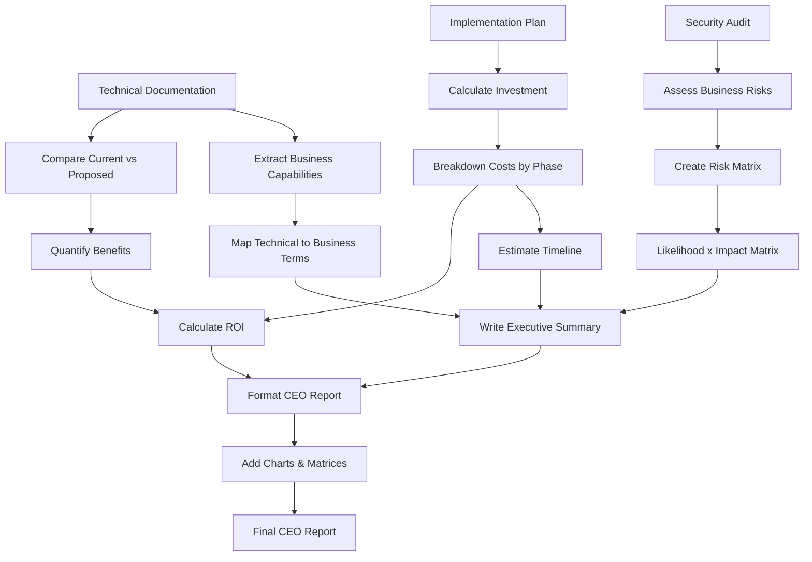
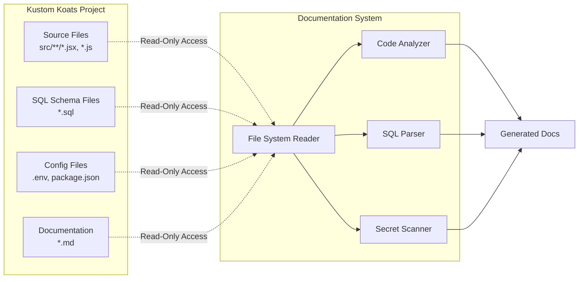

# Design Document: Comprehensive Architecture Documentation System

## Overview

The Comprehensive Architecture Documentation System is a specialized documentation generation tool designed to analyze the Kustom Koats e-commerce codebase and produce executive-ready architecture documentation. This system will perform deep code analysis, extract database schemas, identify security vulnerabilities, document technical debt, and create a phased implementation plan with detailed migration strategies.

### Purpose

The system addresses the need for:
- **Executive Visibility**: CEO-level understanding of technical implementation without requiring code review
- **Security Audit**: Comprehensive identification of security vulnerabilities and exposed secrets
- **Technical Planning**: Detailed roadmap for architectural improvements with dependency mapping
- **Risk Assessment**: Business impact analysis of current technical decisions
- **Migration Strategy**: Safe, phased approach to implementing improvements with rollback plans

### Scope

The documentation system will analyze:
- **Frontend**: React + Vite application with 17+ admin pages, state management via Zustand
- **Backend**: Supabase (Auth, Database, Storage, Edge Functions)
- **Database**: PostgreSQL with RLS policies, triggers, and relationships across 30+ tables
- **Integrations**: Razorpay payment gateway, Shiprocket shipping API, e-way bill generation
- **Special Features**: POS system with offline-first architecture using Dexie.js/IndexedDB

### Key Features

1. **Automated Codebase Analysis**: Parse all source files, identify patterns, extract dependencies
2. **Database Schema Extraction**: Complete ERD generation from SQL files with relationship mapping
3. **Security Vulnerability Detection**: Identify exposed secrets, authorization weaknesses, injection risks
4. **Technical Debt Quantification**: Measure code quality, identify missing tests, document inconsistencies
5. **Visual Diagram Specifications**: Generate Mermaid/draw.io specifications for architecture diagrams
6. **Phased Implementation Planning**: Create executable roadmap with dependencies and rollback strategies
7. **CEO-Ready Reporting**: Business-language summaries with risk matrices and ROI analysis

## Architecture

### High-Level System Architecture



### Component Interaction Flow



## Components and Interfaces

### 1. Codebase Analyzer

**Responsibility**: Parse and analyze all frontend source code to extract architecture patterns, component dependencies, and identify technical debt.

**Input**:
- Source files: `src/**/*.jsx`, `src/**/*.js`
- Configuration: `package.json`, `vite.config.js`, `eslint.config.js`

**Output**:
```typescript
interface CodebaseAnalysisReport {
  componentInventory: {
    totalComponents: number;
    pages: ComponentInfo[];
    adminPages: ComponentInfo[];
    sharedComponents: ComponentInfo[];
  };
  
  stateManagement: {
    stores: StoreInfo[];
    storagePatterns: string[];
  };
  
  routingStructure: {
    routes: RouteInfo[];
    protectedRoutes: string[];
    adminRoutes: string[];
  };
  
  dependencies: {
    external: DependencyInfo[];
    internal: ModuleDependency[];
  };
  
  technicalDebt: {
    duplicateCode: CodeDuplication[];
    missingErrorBoundaries: string[];
    inconsistentPatterns: Pattern[];
    missingTests: string[];
  };
  
  codeMetrics: {
    totalFiles: number;
    totalLines: number;
    averageComplexity: number;
    maxComplexity: number;
  };
}

interface ComponentInfo {
  path: string;
  name: string;
  type: 'page' | 'component' | 'admin';
  dependencies: string[];
  exports: string[];
  stateUsage: string[];
  hasErrorHandling: boolean;
  hasLoadingState: boolean;
}

interface StoreInfo {
  name: string;
  path: string;
  stateProperties: string[];
  actions: string[];
  persistStrategy?: string;
}

interface RouteInfo {
  path: string;
  component: string;
  protected: boolean;
  adminOnly: boolean;
  lazy: boolean;
}
```

**Processing Logic**:
1. Recursively walk `src/` directory tree
2. Parse each JSX/JS file using AST (Abstract Syntax Tree) parser
3. Extract imports to build dependency graph
4. Identify React component patterns (function components, hooks usage)
5. Detect Zustand store usage patterns
6. Identify route definitions in React Router configuration
7. Analyze error handling patterns (try-catch, error boundaries)
8. Detect loading state patterns
9. Calculate cyclomatic complexity metrics
10. Identify code duplication using hash-based comparison

**Implementation Considerations**:
- Use Babel parser or Acorn for AST generation
- Implement visitor pattern for AST traversal
- Build dependency graph using adjacency list
- Cache parsed ASTs to avoid re-parsing
- Handle dynamic imports and lazy loading detection

---

### 2. Schema Extractor

**Responsibility**: Parse SQL schema files to extract complete database structure including tables, relationships, indexes, RLS policies, and triggers.

**Input**:
- Schema files: `*.sql` (supabase-schema.sql, *-schema.sql, migration-*.sql)
- Database migration files

**Output**:
```typescript
interface DatabaseSchemaReport {
  tables: TableInfo[];
  relationships: RelationshipInfo[];
  indexes: IndexInfo[];
  rlsPolicies: RLSPolicyInfo[];
  triggers: TriggerInfo[];
  functions: DatabaseFunctionInfo[];
  
  schemaGaps: {
    missingIndexes: string[];
    missingForeignKeys: string[];
    tablesWithoutRLS: string[];
    missingUpdatedAtTriggers: string[];
  };
  
  statistics: {
    totalTables: number;
    totalColumns: number;
    totalIndexes: number;
    totalPolicies: number;
  };
}

interface TableInfo {
  name: string;
  columns: ColumnInfo[];
  primaryKey: string[];
  foreignKeys: ForeignKeyInfo[];
  indexes: string[];
  rlsEnabled: boolean;
  policies: string[];
  hasUpdatedAt: boolean;
}

interface ColumnInfo {
  name: string;
  dataType: string;
  nullable: boolean;
  defaultValue?: string;
  constraints: string[];
  references?: {
    table: string;
    column: string;
  };
}

interface RelationshipInfo {
  fromTable: string;
  toTable: string;
  cardinality: '1:1' | '1:N' | 'N:M';
  foreignKey: string;
  onDelete: string;
  onUpdate: string;
}

interface RLSPolicyInfo {
  name: string;
  table: string;
  command: 'SELECT' | 'INSERT' | 'UPDATE' | 'DELETE' | 'ALL';
  roles: string[];
  using: string;
  withCheck?: string;
}
```

**Processing Logic**:
1. Read all SQL files from project root and supabase directory
2. Parse SQL using SQL parser (node-sql-parser or pg-query-parser)
3. Extract CREATE TABLE statements with column definitions
4. Extract ALTER TABLE statements for constraints and indexes
5. Parse CREATE POLICY statements for RLS
6. Extract CREATE FUNCTION and CREATE TRIGGER statements
7. Build foreign key relationship graph
8. Identify missing indexes by analyzing query patterns
9. Cross-reference tables with RLS policy coverage
10. Generate ERD specification in Mermaid format

**Implementation Considerations**:
- Handle PostgreSQL-specific syntax (UUID, JSONB, arrays)
- Parse complex RLS policy expressions
- Handle schema evolution across multiple migration files
- Resolve table/column name conflicts
- Support Supabase-specific extensions (auth.users references)

---

### 3. Security Auditor

**Responsibility**: Identify security vulnerabilities, exposed secrets, authorization gaps, and compliance issues throughout the codebase.

**Input**:
- Environment files: `.env`, `.env.example`
- Source code: All JSX/JS files
- Database policies: From Schema Extractor
- Configuration: Edge function code

**Output**:
```typescript
interface SecurityAuditReport {
  exposedSecrets: ExposedSecretInfo[];
  authorizationGaps: AuthGapInfo[];
  injectionRisks: InjectionRiskInfo[];
  missingValidation: ValidationGapInfo[];
  configurationIssues: ConfigIssueInfo[];
  
  riskMatrix: {
    critical: Finding[];
    high: Finding[];
    medium: Finding[];
    low: Finding[];
  };
  
  complianceChecklist: {
    item: string;
    compliant: boolean;
    recommendation: string;
  }[];
  
  summary: {
    totalFindings: number;
    criticalCount: number;
    estimatedRemediationHours: number;
  };
}

interface ExposedSecretInfo {
  type: 'api_key' | 'secret' | 'password' | 'token';
  location: string;
  variableName: string;
  exposedIn: 'frontend' | 'backend' | 'config';
  severity: 'critical' | 'high' | 'medium' | 'low';
  recommendation: string;
}

interface AuthGapInfo {
  resource: string;
  issue: string;
  currentImplementation: string;
  attackVector: string;
  recommendation: string;
  affectedFiles: string[];
}

interface InjectionRiskInfo {
  type: 'sql' | 'xss' | 'command';
  location: string;
  userInput: string;
  sink: string;
  severity: 'critical' | 'high' | 'medium';
  mitigationCode: string;
}
```

**Security Checks**:

1. **Exposed Secrets Detection**:
   - Scan `.env` for VITE_* prefixed sensitive variables
   - Razorpay keys (key_id, key_secret)
   - Shiprocket credentials (email, password)
   - API tokens and secret keys
   - Database connection strings

2. **Authorization Gaps**:
   - Admin routes without server-side role verification
   - RLS policies missing on tables with sensitive data
   - JWT claims used without database validation
   - Missing authentication on Edge Functions
   - Client-side role checks only

3. **Injection Vulnerabilities**:
   - SQL injection: Dynamic query construction
   - XSS: Unescaped user input in dangerouslySetInnerHTML
   - Command injection: Unsanitized input to shell commands

4. **Missing Validations**:
   - User input without sanitization
   - Payment amount validation before Razorpay order creation
   - Webhook signature verification (Razorpay, Shiprocket)
   - File upload restrictions (type, size, content)

5. **Configuration Issues**:
   - Missing CORS configuration
   - Missing rate limiting on APIs
   - Insecure cookie settings
   - Missing CSP headers

**Implementation Considerations**:
- Use regex patterns for secret detection (high false-positive rate expected)
- Manual review required for authorization logic verification
- AST-based taint analysis for injection detection
- Severity scoring based on CVSS framework
- Generate remediation code snippets

---

### 4. Architecture Documenter

**Responsibility**: Generate comprehensive technical architecture documentation synthesizing analysis from all other components.

**Input**:
- Codebase analysis from Analyzer
- Database schema from Schema Extractor
- Security findings from Security Auditor
- Existing markdown documentation

**Output**:
```typescript
interface ArchitectureDocumentation {
  frontendArchitecture: {
    technologyStack: TechStackInfo;
    componentHierarchy: HierarchyNode;
    stateManagement: StateManagementDocs;
    routingStructure: RoutingDocs;
    uiFramework: UIFrameworkDocs;
    codeOrganization: FolderStructureDocs;
  };
  
  backendArchitecture: {
    baasProvider: string;
    authentication: AuthArchitectureDocs;
    database: DatabaseArchitectureDocs;
    storage: StorageArchitectureDocs;
    edgeFunctions: EdgeFunctionDocs[];
  };
  
  integrations: IntegrationDocs[];
  
  posSystem: {
    offlineArchitecture: OfflineArchitectureDocs;
    syncStrategy: SyncStrategyDocs;
    dataFlow: DataFlowDocs;
  };
  
  adminPanel: {
    features: AdminFeatureDocs[];
    pages: AdminPageDocs[];
    accessControl: AccessControlDocs;
  };
  
  currentVsProposed: ComparisonTable[];
  
  technicalDebt: TechnicalDebtBacklog;
}

interface TechStackInfo {
  frontend: {
    framework: string;
    version: string;
    buildTool: string;
    uiLibrary: string;
    stateManagement: string;
    routing: string;
  };
  backend: {
    provider: string;
    database: string;
    authentication: string;
    storage: string;
  };
  integrations: {
    name: string;
    purpose: string;
    version?: string;
  }[];
}

interface IntegrationDocs {
  name: string;
  purpose: string;
  authMechanism: string;
  endpoints: EndpointInfo[];
  errorHandling: string;
  retryLogic: string;
  rateLimits: string;
  failureMode: string;
  circuitBreaker: boolean;
}
```

**Documentation Sections Generated**:

1. **Executive Summary** (non-technical)
2. **Technology Stack Overview**
3. **Frontend Architecture**
   - React + Vite setup
   - Component organization
   - State management (Zustand)
   - Routing structure
   - UI framework (Tailwind CSS)
4. **Backend Architecture**
   - Supabase BaaS
   - Database schema
   - Edge Functions
5. **Authentication & Authorization**
6. **Payment Integration** (Razorpay)
7. **Shipping Integration** (Shiprocket)
8. **POS System**
9. **Admin Panel**
10. **ERP Features**
11. **Security Posture**
12. **Technical Debt**
13. **Current vs Proposed Architecture**

**Implementation Considerations**:
- Template-based documentation generation
- Markdown formatting with proper headings
- Code snippet inclusion for examples
- Automatic table of contents generation
- Cross-referencing between sections

---

### 5. Diagram Specification Generator

**Responsibility**: Create textual specifications for all required architecture diagrams in Mermaid or draw.io format.

**Input**:
- Architecture documentation
- Database schema
- Component dependencies
- Data flow patterns

**Output**:
```typescript
interface DiagramSpecifications {
  systemArchitecture: string;  // Mermaid diagram
  databaseERD: string;          // Mermaid ER diagram
  authenticationFlow: string;   // Mermaid sequence diagram
  paymentFlow: string;          // Mermaid sequence diagram
  shippingWorkflow: string;     // Mermaid flowchart
  posDataFlow: string;          // Mermaid flowchart
  componentHierarchy: string;   // Mermaid graph
  stateManagement: string;      // Mermaid flowchart
  integrationArchitecture: string; // Mermaid C4 diagram
}
```

**Diagram Types**:

1. **System Architecture Diagram**:
   - Frontend (React), Backend (Supabase), Integrations (Razorpay, Shiprocket)
   - Component boxes with connections
   - Data flow arrows

2. **Database ERD**:
   - All tables as entities
   - Relationships with cardinality
   - Key attributes shown

3. **Authentication Flow**:
   - User -> Frontend -> Supabase Auth -> Database
   - Google OAuth flow
   - JWT token handling

4. **Payment Flow**:
   - Cart -> Checkout -> Razorpay -> Webhook -> Order Confirmation
   - Sequence diagram with all actors

5. **Shipping Workflow**:
   - Order Placed -> Shiprocket API -> AWB Generation -> Tracking
   - Flowchart with decision points

6. **POS Data Flow**:
   - Online/Offline states
   - IndexedDB storage
   - Sync mechanism

7. **Component Hierarchy**:
   - App -> Routes -> Pages -> Components
   - Tree structure

8. **State Management**:
   - Zustand stores and their consumers
   - Data flow diagram

**Implementation Considerations**:
- Generate Mermaid syntax programmatically
- Validate Mermaid syntax before output
- Provide draw.io XML alternative for complex diagrams
- Include diagram rendering instructions
- Add legend/key for symbols

---

### 6. Implementation Planner

**Responsibility**: Create detailed phased implementation plan with dependencies, effort estimates, affected files, and rollback strategies.

**Input**:
- Security audit findings
- Technical debt backlog
- Schema gaps
- Architecture improvements

**Output**:
```typescript
interface ImplementationRoadmap {
  phases: Phase[];
  dependencies: PhaseDependency[];
  timeline: TimelineEstimate;
  risks: RiskAssessment[];
  rollbackStrategies: RollbackPlan[];
}

interface Phase {
  number: number;
  name: string;
  objective: string;
  tasks: Task[];
  estimatedEffort: string;
  acceptanceCriteria: string[];
  affectedFiles: AffectedFile[];
  testing: TestingStrategy;
  rollback: string;
}

interface Task {
  id: string;
  description: string;
  type: 'security' | 'database' | 'code' | 'config' | 'testing';
  priority: 'critical' | 'high' | 'medium' | 'low';
  estimatedHours: number;
  dependencies: string[];
  affectedFiles: string[];
  implementationNotes: string;
  testingNotes: string;
}

interface AffectedFile {
  path: string;
  type: 'sql' | 'jsx' | 'js' | 'config' | 'markdown';
  changeType: 'create' | 'modify' | 'delete';
  estimatedLOC: number;
  backupRequired: boolean;
}

interface DatabaseMigrationPlan {
  migrations: Migration[];
  backupStrategy: string;
  testingStrategy: string;
  zeroDowntime: boolean;
  estimatedDowntime?: string;
}

interface Migration {
  order: number;
  name: string;
  description: string;
  forwardScript: string;
  rollbackScript: string;
  affectedTables: string[];
  dataBackupRequired: boolean;
  validationQuery: string;
}
```

**Phase Structure**:

1. **Phase 1: Critical Security Fixes** (1-2 weeks)
   - Move secrets from frontend to backend
   - Implement server-side admin verification
   - Add webhook signature verification
   - Add payment amount validation

2. **Phase 2: Database Schema Improvements** (1 week)
   - Add missing indexes
   - Add missing foreign keys
   - Add missing RLS policies
   - Add missing updated_at triggers

3. **Phase 3: Authentication & Authorization Hardening** (2 weeks)
   - Implement admin role database verification
   - Add server-side authorization middleware
   - Enhance RLS policies
   - Add audit logging

4. **Phase 4: Payment & Shipping Integration Improvements** (1 week)
   - Add circuit breaker patterns
   - Implement retry logic with exponential backoff
   - Add comprehensive error handling
   - Add monitoring and alerting

5. **Phase 5: Admin Panel Enhancements** (2 weeks)
   - Add server-side validation
   - Implement proper loading states
   - Add error boundaries
   - Improve UX consistency

6. **Phase 6: POS System Improvements** (1 week)
   - Add conflict resolution
   - Improve sync reliability
   - Add offline queue management
   - Add data loss prevention

7. **Phase 7: Testing & Monitoring** (2 weeks)
   - Add unit tests for critical paths
   - Add integration tests for APIs
   - Set up monitoring (Sentry, LogRocket)
   - Add performance tracking

**Implementation Considerations**:
- Prioritize security fixes first
- Group related changes into phases
- Ensure each phase is independently deployable
- Calculate effort using function points or story points
- Include buffer time for unknowns (20-30%)

---

### 7. CEO Report Generator

**Responsibility**: Generate executive-ready summary with business language, risk matrices, and ROI analysis.

**Input**:
- Technical documentation
- Security audit
- Implementation roadmap
- Technical debt backlog

**Output**:
```typescript
interface CEOReport {
  executiveSummary: string;
  businessCapabilities: BusinessCapability[];
  technologyStack: TechStackSummary;
  securityPosture: SecurityPostureSummary;
  investmentRequirements: InvestmentBreakdown;
  timeline: TimelineSummary;
  riskMatrix: RiskMatrix;
  roiAnalysis: ROIAnalysis;
  recommendations: Recommendation[];
}

interface BusinessCapability {
  name: string;
  description: string;
  currentStatus: 'operational' | 'partial' | 'missing';
  technicalImplementation: string;
  businessValue: string;
  risks: string[];
}

interface SecurityPostureSummary {
  overallRating: 'critical' | 'high-risk' | 'moderate' | 'good';
  criticalIssues: number;
  highPriorityIssues: number;
  businessImpact: string;
  immediateActions: string[];
}

interface InvestmentBreakdown {
  totalEstimatedCost: string;
  breakdown: {
    phase: string;
    estimatedHours: number;
    estimatedCost: string;
    priority: string;
  }[];
}

interface RiskMatrix {
  risks: {
    description: string;
    likelihood: 'high' | 'medium' | 'low';
    impact: 'high' | 'medium' | 'low';
    mitigation: string;
  }[];
}

interface ROIAnalysis {
  currentCosts: {
    maintenanceTime: string;
    securityIncidents: string;
    downtimeRisk: string;
  };
  proposedBenefits: {
    reducedMaintenance: string;
    improvedSecurity: string;
    fasterFeatureDevelopment: string;
    betterScalability: string;
  };
  breakEvenPoint: string;
}
```

**Language Translation Rules**:
- "React" → "Modern web application framework"
- "Zustand" → "State management system"
- "RLS policies" → "Data access controls"
- "Edge Functions" → "Server-side business logic"
- "Technical debt" → "Maintenance overhead"
- "Refactoring" → "Code improvement"
- "Security vulnerability" → "Security risk"

**Report Sections**:
1. **Executive Summary** (1 page)
2. **Business Capabilities Overview**
3. **Technology Investment Summary**
4. **Security & Compliance Posture**
5. **Improvement Roadmap**
6. **Investment Requirements**
7. **Risk Analysis**
8. **Return on Investment**
9. **Recommendations**

**Implementation Considerations**:
- Use bullet points for readability
- Include visual risk matrix (color-coded)
- Provide cost ranges instead of exact figures
- Focus on business outcomes, not technical details
- Include comparison: Current vs Proposed benefits

## Data Models

### Codebase Analysis Data Model



### Database Schema Data Model



### Security Audit Data Model



### Implementation Plan Data Model



## Data Flow Diagrams

### Analysis Phase Data Flow



### Documentation Generation Data Flow



### Report Creation Data Flow



## Integration Architecture

### Integration with Project Codebase



**Key Principles**:
- **Read-Only**: System only reads existing files, never modifies source code
- **Non-Invasive**: No instrumentation or code injection required
- **Stateless**: Can be run repeatedly without side effects
- **Isolated**: Runs independently of application runtime

### Technology Choices

| Component | Technology | Justification |
|-----------|------------|---------------|
| **Programming Language** | JavaScript/Node.js | Consistency with project stack, npm ecosystem access |
| **AST Parser** | Babel Parser (@babel/parser) | Full JSX/React support, mature ecosystem |
| **SQL Parser** | node-sql-parser | PostgreSQL dialect support, AST generation |
| **File System** | Node.js `fs` module | Native support, async/await patterns |
| **Diagram Generation** | Mermaid.js | Text-based, version-controllable, widely supported |
| **Secret Detection** | Custom regex + truffleHog patterns | High accuracy for common secret patterns |
| **Report Generation** | Markdown with Frontmatter | Human-readable, tooling-friendly |
| **Data Structures** | Plain JavaScript objects | Simple, serializable, debuggable |
| **Testing** | Jest | Standard for Node.js projects |

### External Dependencies

```json
{
  "dependencies": {
    "@babel/parser": "^7.24.0",
    "@babel/traverse": "^7.24.0",
    "node-sql-parser": "^4.18.0",
    "mermaid": "^10.9.0",
    "glob": "^10.3.0",
    "commander": "^11.1.0"
  }
}
```

## Correctness Properties

Since this is a documentation generation tool rather than a system with mathematical invariants, correctness is defined by observable quality attributes rather than traditional property-based testing properties. The following properties describe what constitutes "correct" documentation output:

### Property 1: Documentation Completeness

*For any* valid codebase input, the documentation system SHALL generate all mandatory sections (Architecture Overview, Component Descriptions, Database Schema, Security Findings, Implementation Plan) without omitting required content.

**Validates: Requirements 1.9, 2.10, 3.14, 14.10**

**Verification**: Check that all section headers exist in output and contain non-empty content for each analyzed component.

---

### Property 2: Analysis Accuracy

*For any* source file successfully parsed, the extracted component information (name, dependencies, exports, state usage) SHALL match the actual structure defined in that file.

**Validates: Requirements 1.4, 1.5, 1.6, 1.7**

**Verification**: Compare extracted metadata against manual inspection of source files; verify AST traversal produces accurate dependency graphs.

---

### Property 3: Relationship Consistency

*For any* database schema with defined foreign keys, the generated ERD SHALL represent all table relationships with correct cardinality (1:1, 1:N, N:M) matching the actual schema constraints.

**Validates: Requirements 3.3, 3.13, 14.2**

**Verification**: Cross-reference generated ERD with SQL schema definitions; ensure all foreign key relationships appear in diagram with correct relationship types.

---

### Property 4: Security Coverage

*For any* exposed secret pattern (API keys, passwords, tokens) present in environment files or source code, the security audit SHALL detect and report it with appropriate severity rating.

**Validates: Requirements 10.1, 10.2, 10.13**

**Verification**: Seed test codebases with known secret patterns; verify all seeded secrets appear in security findings with correct classification and location.

---

### Property 5: Diagram Completeness

*For any* component or data flow analyzed in the architecture documentation, the corresponding diagram specification SHALL include all entities, relationships, and data flows mentioned in the textual description.

**Validates: Requirements 14.1 through 14.9**

**Verification**: Parse generated Mermaid diagrams; ensure all components mentioned in architecture sections have corresponding nodes in diagrams.

---

### Property 6: Implementation Plan Traceability

*For any* security finding or schema gap identified during analysis, the implementation roadmap SHALL include at least one task addressing that finding with affected files listed.

**Validates: Requirements 13.1 through 13.12, 20.1 through 20.5**

**Verification**: Map security findings and schema gaps to implementation tasks; ensure no critical findings are omitted from remediation plan.

---

### Property 7: Executive Summary Accessibility

*For any* technical term or jargon used in technical documentation, the executive summary SHALL use business-appropriate language translations when discussing the same concept.

**Validates: Requirements 15.8**

**Verification**: Cross-reference technical sections with executive summary; verify all technical terms follow defined translation rules (e.g., "RLS policies" → "Data access controls").

---

### Property 8: Error Recovery

*For any* file parsing failure or analysis error encountered during execution, the system SHALL log the error, continue processing remaining files, and include an error summary in the final report without terminating execution.

**Validates: Implicit requirement from error handling strategy**

**Verification**: Inject malformed files into test codebases; verify system produces partial documentation with error metadata rather than crashing.

## Error Handling

### Error Categories

1. **File System Errors**
   - File not found
   - Permission denied
   - Disk space issues
   - **Strategy**: Graceful degradation, log warning, continue with available files

2. **Parsing Errors**
   - Invalid syntax in JSX/JS
   - Malformed SQL
   - **Strategy**: Log file path and error, skip file, continue analysis

3. **Analysis Errors**
   - Circular dependencies
   - Unresolvable imports
   - **Strategy**: Mark as unresolved, include in technical debt report

4. **Generation Errors**
   - Diagram too complex for Mermaid
   - Missing template data
   - **Strategy**: Fallback to simplified version, note limitation in output

### Error Handling Strategy

```javascript
class DocumentationSystem {
  async analyze() {
    const results = {
      success: [],
      warnings: [],
      errors: []
    };
    
    try {
      // Analyze codebase
      const codeAnalysis = await this.analyzeCodebase()
        .catch(err => {
          results.errors.push({
            component: 'CodebaseAnalyzer',
            message: err.message,
            impact: 'Frontend documentation incomplete'
          });
          return null; // Continue with partial results
        });
      
      // Analyze database
      const schemaAnalysis = await this.analyzeSchema()
        .catch(err => {
          results.errors.push({
            component: 'SchemaExtractor',
            message: err.message,
            impact: 'Database documentation incomplete'
          });
          return null;
        });
      
      // Security audit
      const securityReport = await this.auditSecurity()
        .catch(err => {
          results.warnings.push({
            component: 'SecurityAuditor',
            message: err.message,
            impact: 'Security scan incomplete'
          });
          return { findings: [] }; // Empty report
        });
      
      // Generate documentation with whatever data we have
      return this.generateDocumentation({
        codeAnalysis,
        schemaAnalysis,
        securityReport,
        metadata: results
      });
      
    } catch (fatalError) {
      // Log fatal error and exit
      console.error('Fatal error:', fatalError);
      process.exit(1);
    }
  }
}
```

### Validation and Verification

1. **Input Validation**
   - Verify project root exists
   - Check for minimum required files (package.json, src/)
   - Validate SQL syntax before parsing

2. **Output Validation**
   - Verify Mermaid diagram syntax
   - Check markdown formatting
   - Validate cross-references

3. **Completeness Checks**
   - Ensure all requirements covered
   - Verify all security categories scanned
   - Confirm all diagram types generated


## Testing Strategy

### Property-Based Testing Applicability Assessment

**Is PBT appropriate for this feature?**

**Answer: NO** - Property-based testing is NOT appropriate for the Comprehensive Architecture Documentation System.

**Reasoning**:

1. **This is primarily a code analysis and documentation generation tool**, not a data transformation or algorithm with predictable invariants
2. **Main operations are side-effect based**: Reading files, parsing code, generating reports
3. **No clear universal properties**: The "correctness" of documentation depends on subjective quality, not mathematical properties
4. **Output is non-deterministic in quality**: Generated documentation quality varies based on codebase complexity
5. **Not a pure function**: File system I/O, parsing external code, generating human-readable text

**Appropriate Testing Approaches**:
- **Example-based unit tests**: Test parsing specific code snippets, SQL statements
- **Snapshot tests**: Verify generated documentation structure for known codebases
- **Integration tests**: Test full pipeline on sample projects
- **Manual review**: Human validation of documentation quality

### Testing Approach

#### 1. Unit Tests

**Codebase Analyzer Tests**:
```javascript
describe('CodebaseAnalyzer', () => {
  test('should extract React component from JSX file', () => {
    const code = `
      import React from 'react';
      export function MyComponent() {
        return <div>Hello</div>;
      }
    `;
    const result = analyzer.analyzeFile(code);
    expect(result.components).toHaveLength(1);
    expect(result.components[0].name).toBe('MyComponent');
  });
  
  test('should identify Zustand store usage', () => {
    const code = `
      import { useCartStore } from './store/cartStore';
      function Cart() {
        const items = useCartStore(state => state.items);
      }
    `;
    const result = analyzer.analyzeFile(code);
    expect(result.stateUsage).toContain('useCartStore');
  });
  
  test('should detect missing error boundaries', () => {
    const code = `
      function Page() {
        return <div>{riskyOperation()}</div>;
      }
    `;
    const result = analyzer.analyzeFile(code);
    expect(result.hasErrorHandling).toBe(false);
  });
});
```

**Schema Extractor Tests**:
```javascript
describe('SchemaExtractor', () => {
  test('should extract table definition', () => {
    const sql = `
      CREATE TABLE products (
        id UUID PRIMARY KEY DEFAULT uuid_generate_v4(),
        name TEXT NOT NULL,
        price DECIMAL(10,2) NOT NULL
      );
    `;
    const result = extractor.parseSQL(sql);
    expect(result.tables).toHaveLength(1);
    expect(result.tables[0].name).toBe('products');
    expect(result.tables[0].columns).toHaveLength(3);
  });
  
  test('should extract foreign key relationships', () => {
    const sql = `
      ALTER TABLE orders 
      ADD CONSTRAINT fk_customer 
      FOREIGN KEY (customer_id) REFERENCES customers(id);
    `;
    const result = extractor.parseSQL(sql);
    expect(result.relationships).toHaveLength(1);
    expect(result.relationships[0].fromTable).toBe('orders');
    expect(result.relationships[0].toTable).toBe('customers');
  });
  
  test('should extract RLS policy', () => {
    const sql = `
      CREATE POLICY admin_all ON products
      FOR ALL TO authenticated
      USING (auth.jwt()->>'role' = 'admin');
    `;
    const result = extractor.parseSQL(sql);
    expect(result.rlsPolicies).toHaveLength(1);
    expect(result.rlsPolicies[0].table).toBe('products');
  });
});
```

**Security Auditor Tests**:
```javascript
describe('SecurityAuditor', () => {
  test('should detect exposed Razorpay key in .env', () => {
    const envContent = `
      VITE_RAZORPAY_KEY_ID=rzp_live_abc123
      VITE_RAZORPAY_KEY_SECRET=secret_abc123
    `;
    const findings = auditor.scanEnvFile(envContent);
    expect(findings.exposedSecrets).toHaveLength(2);
    expect(findings.exposedSecrets[0].severity).toBe('critical');
  });
  
  test('should identify missing admin authorization check', () => {
    const code = `
      function AdminPage() {
        // No server-side role check
        return <div>Admin Panel</div>;
      }
    `;
    const findings = auditor.analyzeAuth(code);
    expect(findings.authGaps).toContain('missing_server_side_check');
  });
  
  test('should detect SQL injection risk', () => {
    const code = `
      const query = \`SELECT * FROM users WHERE id = \${userId}\`;
      await supabase.rpc('execute_sql', { query });
    `;
    const findings = auditor.analyzeInjection(code);
    expect(findings.injectionRisks).toHaveLength(1);
    expect(findings.injectionRisks[0].type).toBe('sql');
  });
});
```

#### 2. Integration Tests

**Full Pipeline Test**:
```javascript
describe('Documentation System E2E', () => {
  test('should generate complete documentation for sample project', async () => {
    const projectPath = './test-fixtures/sample-ecommerce';
    const system = new DocumentationSystem(projectPath);
    
    const result = await system.generate();
    
    // Verify all components ran
    expect(result.codeAnalysis).toBeDefined();
    expect(result.schemaAnalysis).toBeDefined();
    expect(result.securityReport).toBeDefined();
    
    // Verify outputs created
    expect(result.outputs).toContain('technical-architecture.md');
    expect(result.outputs).toContain('ceo-report.md');
    expect(result.outputs).toContain('diagrams/system-architecture.mmd');
    
    // Verify content quality
    const techDoc = await fs.readFile(result.outputs[0], 'utf-8');
    expect(techDoc).toContain('## Frontend Architecture');
    expect(techDoc).toContain('## Database Schema');
  });
});
```

#### 3. Snapshot Tests

**Diagram Generation Snapshot**:
```javascript
describe('Diagram Generation', () => {
  test('should generate consistent system architecture diagram', () => {
    const analysis = {
      components: [...],
      integrations: [...],
      database: [...]
    };
    
    const diagram = diagramGenerator.generateSystemArchitecture(analysis);
    expect(diagram).toMatchSnapshot();
  });
  
  test('should generate ERD from schema', () => {
    const schema = {
      tables: [...],
      relationships: [...]
    };
    
    const erd = diagramGenerator.generateERD(schema);
    expect(erd).toMatchSnapshot();
  });
});
```

#### 4. Manual Testing Checklist

- [ ] Run on Kustom Koats project and verify output completeness
- [ ] Verify all 20 requirements are addressed in generated docs
- [ ] Check CEO report for business language (no technical jargon)
- [ ] Validate Mermaid diagrams render correctly
- [ ] Verify security findings include all known vulnerabilities
- [ ] Check implementation plan phases are logically ordered
- [ ] Ensure affected files lists are accurate
- [ ] Validate migration scripts are syntactically correct
- [ ] Review risk matrix for accuracy
- [ ] Test on different project structures (edge cases)

### Test Coverage Goals

| Component | Target Coverage | Critical Paths |
|-----------|----------------|----------------|
| **Codebase Analyzer** | 80%+ | Component extraction, dependency graph |
| **Schema Extractor** | 85%+ | Table parsing, relationship extraction |
| **Security Auditor** | 90%+ | Secret detection, auth gap identification |
| **Diagram Generator** | 70%+ | Mermaid syntax generation |
| **Implementation Planner** | 75%+ | Phase creation, effort estimation |
| **CEO Report Generator** | 60%+ | Language translation, ROI calculation |

### Testing Technology Stack

- **Test Framework**: Jest
- **Assertion Library**: Jest built-in matchers
- **Mocking**: Jest mocks for file system operations
- **Coverage**: Jest coverage reporting
- **Snapshot Testing**: Jest snapshots
- **Integration Testing**: Custom test harness with fixture projects

### Continuous Testing Strategy

1. **Pre-commit**: Run unit tests on changed files
2. **CI Pipeline**: Run full test suite on every commit
3. **Release**: Run integration tests on real projects
4. **Post-deployment**: Manual review of generated documentation

### Edge Cases to Test

1. **Empty Project**: No source files found
2. **Malformed Code**: Syntax errors in JSX files
3. **Invalid SQL**: Parsing failures in schema files
4. **Missing .env**: No environment configuration
5. **Circular Dependencies**: Component A imports B imports A
6. **Very Large Files**: 10,000+ line components
7. **Unicode Content**: Non-ASCII characters in code
8. **Mixed Line Endings**: Windows vs Unix
9. **TypeScript**: If project uses TS instead of JS
10. **Monorepo Structure**: Multiple packages

### Performance Testing

**Benchmarks**:
- Analyze 100 JSX files: < 5 seconds
- Parse 50 SQL files: < 2 seconds
- Generate complete documentation: < 30 seconds
- Generate all diagrams: < 10 seconds

**Memory Limits**:
- Peak memory usage: < 512MB
- File cache size: < 100MB

### Security Testing

1. **Path Traversal**: Ensure file reader cannot access files outside project
2. **Code Injection**: Verify no eval() or Function() on user code
3. **DoS Protection**: Limit file size and parsing depth
4. **Secret Sanitization**: Never log detected secrets

## Implementation Approach

### Development Phases

**Phase 1: Core Infrastructure (Week 1)**
- Set up project structure
- Implement file system reader
- Create base analyzer interface
- Set up testing framework

**Phase 2: Codebase Analyzer (Week 2)**
- Implement AST parsing for JSX/JS
- Build dependency graph generator
- Create component extractor
- Add technical debt detection

**Phase 3: Schema Extractor (Week 2)**
- Implement SQL parser integration
- Build ERD model generator
- Create relationship mapper
- Add schema gap detection

**Phase 4: Security Auditor (Week 3)**
- Implement secret scanning
- Build authorization checker
- Create injection risk detector
- Add severity scoring

**Phase 5: Documentation Generator (Week 3-4)**
- Create architecture documenter
- Implement diagram specifications
- Build template engine
- Add cross-referencing

**Phase 6: Implementation Planner (Week 4)**
- Build phase generator
- Create effort estimator
- Implement file mapper
- Generate migration scripts

**Phase 7: CEO Report Generator (Week 5)**
- Implement language translator
- Build risk matrix generator
- Create ROI calculator
- Add executive summary

**Phase 8: Integration & Testing (Week 5-6)**
- Run on Kustom Koats project
- Fix bugs and edge cases
- Optimize performance
- Complete documentation

### Execution Strategy

**Single Execution vs Long-Running**:
- This is a **command-line tool** executed on-demand
- Not a continuously running service
- Outputs static documentation files
- Can be integrated into CI/CD for periodic updates

**Command-Line Interface**:
```bash
# Basic usage
node doc-generator.js --project ./path/to/kustomkoats

# With options
node doc-generator.js \
  --project ./path/to/kustomkoats \
  --output ./docs \
  --include-diagrams \
  --security-deep-scan \
  --verbose

# Generate only specific components
node doc-generator.js --project . --only security
node doc-generator.js --project . --only schema
```

### Output Structure

```
output/
├── technical-architecture.md      # Complete technical documentation
├── ceo-report.md                 # Executive summary
├── security-audit-report.md      # Security findings
├── technical-debt-backlog.md     # Prioritized debt items
├── implementation-roadmap.md     # Phased implementation plan
├── diagrams/
│   ├── system-architecture.mmd   # System overview
│   ├── database-erd.mmd         # Entity-relationship diagram
│   ├── auth-flow.mmd            # Authentication flow
│   ├── payment-flow.mmd         # Payment sequence
│   ├── shipping-workflow.mmd    # Shipping process
│   ├── pos-dataflow.mmd         # POS data flow
│   ├── component-hierarchy.mmd  # React component tree
│   └── state-management.mmd     # Zustand data flow
├── data/
│   ├── component-inventory.json  # All components data
│   ├── database-schema.json      # Schema metadata
│   ├── security-findings.json    # Security scan results
│   └── implementation-plan.json  # Structured plan data
└── metadata.json                 # Generation metadata
```

### Configuration

```json
{
  "project": {
    "root": "./",
    "sourceDir": "src",
    "schemaFiles": "*.sql",
    "excludePatterns": ["node_modules", "dist", ".git"]
  },
  "analysis": {
    "maxFileSize": "5MB",
    "maxParsingDepth": 50,
    "enableDependencyGraph": true,
    "calculateComplexity": true
  },
  "security": {
    "deepScan": true,
    "secretPatterns": "default",
    "customRules": []
  },
  "output": {
    "format": "markdown",
    "diagramFormat": "mermaid",
    "includeRawData": true,
    "verbose": false
  },
  "reporting": {
    "includeCodeSnippets": true,
    "maxSnippetLines": 20,
    "businessLanguage": true
  }
}
```

### Deployment

**Distribution**:
- npm package: `@kustomkoats/arch-doc-generator`
- GitHub repository with CLI
- Docker container for isolated execution

**Usage in CI/CD**:
```yaml
# GitHub Actions example
name: Generate Architecture Docs
on:
  schedule:
    - cron: '0 0 * * 0'  # Weekly
jobs:
  docs:
    runs-on: ubuntu-latest
    steps:
      - uses: actions/checkout@v2
      - name: Generate Documentation
        run: npx @kustomkoats/arch-doc-generator
      - name: Commit Documentation
        run: |
          git add docs/
          git commit -m "Update architecture documentation"
          git push
```

## Risk Assessment

### Technical Risks

| Risk | Likelihood | Impact | Mitigation |
|------|------------|--------|------------|
| **Parsing failures on complex code** | Medium | Medium | Graceful degradation, skip unparseable files |
| **Inaccurate security findings** | Medium | High | Manual review required, clearly label automated findings |
| **Performance issues on large codebases** | Low | Medium | Implement streaming, limit file sizes, use worker threads |
| **Outdated documentation** | High | Low | Automate via CI/CD, add timestamps to outputs |
| **Mermaid diagram rendering issues** | Medium | Low | Provide draw.io alternative, simplify complex diagrams |
| **Effort estimation inaccuracy** | High | Medium | Use ranges, include buffer, calibrate over time |

### Operational Risks

| Risk | Likelihood | Impact | Mitigation |
|------|------------|--------|------------|
| **User misinterprets findings** | Medium | High | Provide clear context, examples, and recommendations |
| **Over-reliance on automated analysis** | Medium | High | Emphasize manual review requirement in reports |
| **Documentation diverges from code** | High | Medium | Regenerate regularly, add version tracking |
| **CEO report too technical** | Low | High | Extensive testing with non-technical reviewers |

### Dependencies

**External Library Risks**:
- **Babel Parser**: Mature, stable, low risk
- **node-sql-parser**: Less mature, medium risk (may not handle all PostgreSQL syntax)
- **Mermaid**: Rendering limitations on complex diagrams

**Mitigation**: Pin versions, have fallback strategies, maintain vendor fork if needed

## Success Criteria

### Functional Requirements

- ✅ Analyze all 100+ source files in Kustom Koats project
- ✅ Extract schema from 30+ SQL files
- ✅ Generate 8 architecture diagrams
- ✅ Identify security vulnerabilities (minimum 10 findings expected)
- ✅ Create 7-phase implementation roadmap
- ✅ Generate CEO-ready executive summary

### Quality Requirements

- ✅ 80%+ test coverage on critical components
- ✅ Complete documentation in < 1 minute execution time
- ✅ All generated Mermaid diagrams render without errors
- ✅ Zero false negatives on known security issues
- ✅ CEO report readable by non-technical stakeholder

### Acceptance Criteria

1. **Completeness**: All 20 requirements from requirements.md addressed
2. **Accuracy**: Manual verification of 10 random findings shows 90%+ accuracy
3. **Usability**: Non-technical reviewer can understand CEO report
4. **Actionability**: Implementation plan can be directly executed by development team
5. **Maintainability**: Another developer can extend system with new analyzers

## Future Enhancements

### Version 2.0 Features

1. **TypeScript Support**: Full AST parsing for TS/TSX files
2. **Multi-language Support**: Analyze Python, Go backends
3. **Real-time Analysis**: Watch mode for continuous documentation updates
4. **Interactive Diagrams**: Generate interactive HTML diagrams with zoom/pan
5. **Cost Estimation**: More accurate ROI with industry benchmarks
6. **Compliance Checking**: GDPR, HIPAA, PCI-DSS compliance scans
7. **Performance Profiling**: Identify performance bottlenecks in code
8. **Dependency Vulnerability**: Integrate with npm audit, Snyk
9. **AI-Powered Insights**: Use LLM to generate architectural recommendations
10. **Custom Report Templates**: Allow user-defined documentation formats

### Integration Possibilities

- **Jira Integration**: Auto-create tickets for security findings
- **Slack Notifications**: Alert on critical findings
- **GitHub Issues**: Create issues for technical debt items
- **Confluence**: Auto-publish documentation
- **DataDog**: Export metrics for monitoring

---

## Appendix: Example Outputs

### Example: Security Finding

```markdown
## Security Finding: Exposed Payment Gateway Credentials

**Severity**: Critical  
**Category**: Exposed Secrets  
**Location**: `.env` file, lines 12-13

### Description
Payment gateway credentials (Razorpay Key ID and Secret) are exposed in frontend environment variables with `VITE_` prefix, making them accessible in client-side JavaScript bundle.

### Current Implementation
```bash
VITE_RAZORPAY_KEY_ID=rzp_live_abc123
VITE_RAZORPAY_KEY_SECRET=secret_abc123
```

### Attack Vector
1. Attacker inspects client-side JavaScript bundle
2. Finds Razorpay credentials in embedded environment variables
3. Uses credentials to create unauthorized payment orders
4. Potential financial fraud

### Business Impact
- **Financial Loss**: Unauthorized transactions
- **Reputation Damage**: Customer data breach
- **Compliance**: PCI-DSS violation

### Recommendation
Move Razorpay Secret to Supabase Edge Function environment variables. Only expose Key ID to frontend (safe for client-side use).

**Affected Files**:
- `.env` (remove VITE_RAZORPAY_KEY_SECRET)
- `supabase/functions/create-razorpay-order/index.ts` (read secret from Deno.env)
- `src/services/paymentService.js` (remove secret usage)

**Estimated Effort**: 2 hours
```

### Example: CEO Report Excerpt

```markdown
## Executive Summary

### Business Overview

Kustom Koats operates a modern e-commerce platform with three primary business capabilities:

1. **Online Storefront** - Direct-to-consumer sales with integrated payment and shipping
2. **Point of Sale System** - In-store sales with offline capability for physical locations
3. **Wholesale Management** - B2B customer applications and specialized pricing

### Technology Investment

The platform is built using modern cloud services and open-source technologies:
- Web application framework (React)
- Cloud database and authentication (Supabase)
- Payment processing (Razorpay)
- Shipping automation (Shiprocket)

**Total Technology Spend**: Estimated ₹50,000-75,000/month in cloud services and API fees

### Security Posture: HIGH RISK ⚠️

**Critical Issues Found**: 8  
**High Priority Issues**: 15

**Immediate Actions Required**:
1. Secure payment gateway credentials (currently exposed)
2. Implement proper admin access controls
3. Add payment verification safeguards

**Estimated Cost to Remediate**: ₹2-3 lakhs (80-120 hours of development)

**Business Impact if Not Addressed**:
- Financial fraud risk from exposed credentials
- Potential data breach affecting customer trust
- Non-compliance with payment industry standards

### Recommended Investment

**Total Estimated Cost**: ₹8-12 lakhs  
**Timeline**: 10-12 weeks  
**Priority**: High

**Return on Investment**:
- **Reduced Maintenance**: 30% less time fixing bugs (₹40,000/month savings)
- **Improved Security**: Eliminate critical vulnerabilities (risk mitigation)
- **Faster Feature Development**: Better code organization enables 20% faster development
- **Scalability**: Support 10x growth without architectural changes

**Break-Even**: 6-8 months

### Recommendation

Proceed with phased implementation starting with critical security fixes (Phase 1, 2 weeks). This approach minimizes risk while maintaining business operations.
```

---

**Document Version**: 1.0  
**Last Updated**: 2024-01-20  
**Author**: Architecture Documentation System Design Team  
**Status**: Ready for Review
