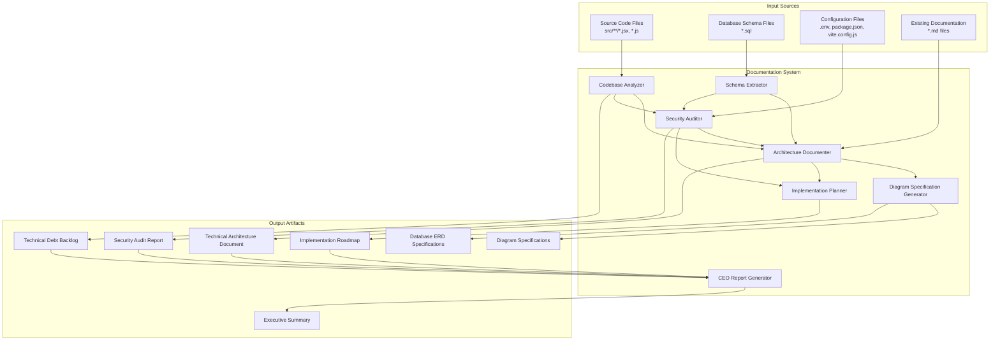
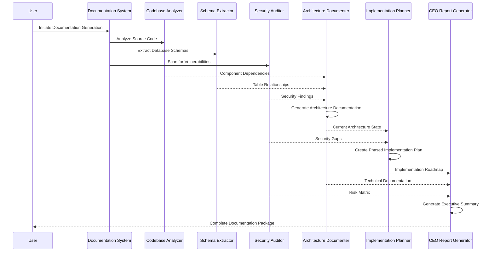
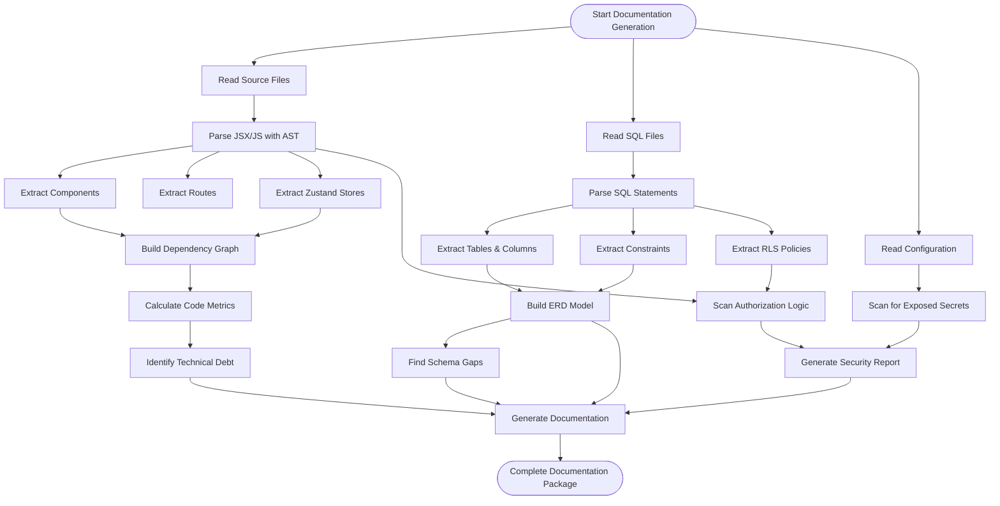
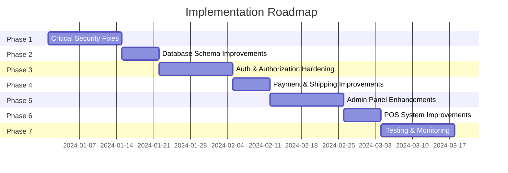
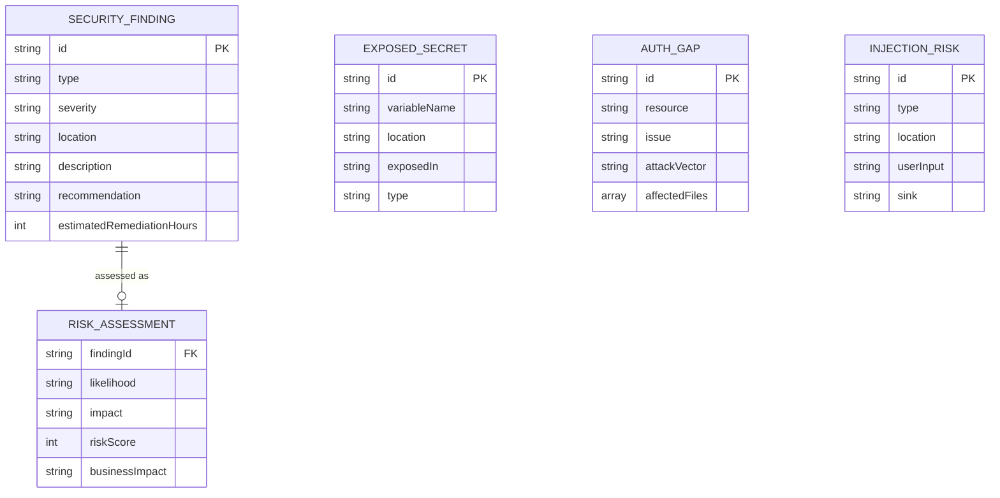
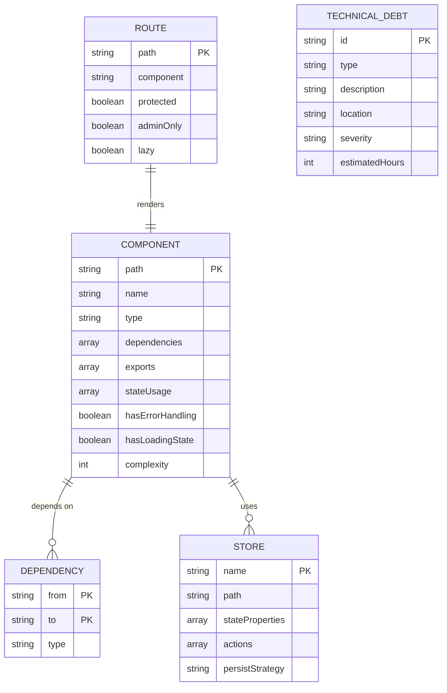

# Kustom Koats Architecture Workflow Diagrams

This document contains the key architecture and workflow diagrams for the Kustom Koats e-commerce platform.

---

## 1. System Architecture Overview



---

## 2. Component Interaction Flow



---

## 3. Analysis Phase Data Flow



---

## 4. Database Schema Data Model

```mermaid
erDiagram
    TABLE_INFO {
        string name PK
        boolean rlsEnabled
        boolean hasUpdatedAt
        int columnCount
    }
    
    COLUMN_INFO {
        string tableName PK_FK
        string name PK
        string dataType
        boolean nullable
        string defaultValue
        array constraints
    }
    
    RELATIONSHIP {
        string id PK
        string fromTable FK
        string toTable FK
        string cardinality
        string foreignKey
        string onDelete
        string onUpdate
    }
    
    RLS_POLICY {
        string name PK
        string table FK
        string command
        array roles
        string usingClause
        string withCheckClause
    }
    
    INDEX_INFO {
        string name PK
        string table FK
        array columns
        string type
    }
    
    TABLE_INFO ||--o{ COLUMN_INFO : "has"
    TABLE_INFO ||--o{ RLS_POLICY : "protected by"
    TABLE_INFO ||--o{ INDEX_INFO : "indexed by"
    TABLE_INFO ||--o{ RELATIONSHIP : "relates to"
```

---

## 5. Implementation Phases Overview



---

## 6. Security Audit Data Model



---

## 7. Codebase Analysis Data Model



---

## How to Use These Diagrams

### Viewing Options:

1. **In VS Code**: 
   - Open this file in VS Code
   - Press `Ctrl+Shift+V` for Markdown Preview
   - Diagrams will render automatically

2. **Online Mermaid Editor**:
   - Copy any diagram code block
   - Visit https://mermaid.live/
   - Paste and view interactive diagram

3. **Export to draw.io**:
   - Open https://mermaid.live/
   - Paste diagram code
   - Click "Export" → "PNG" or "SVG"
   - Import into draw.io for further editing

4. **Documentation Sites**:
   - These diagrams work in GitHub, GitLab, Notion
   - Copy entire markdown file for sharing

---

## Diagram Legend

| Symbol | Meaning |
|--------|---------|
| Rectangle | Component/Module |
| Diamond | Decision Point |
| Cylinder | Database/Storage |
| Arrow → | Data Flow |
| Dotted Arrow ⇢ | Async/Event Flow |
| ||--o{ | One-to-Many Relationship |
| ||--|| | One-to-One Relationship |

---

## Next Steps

These diagrams represent the planned architecture documentation system. To implement:

1. Review the requirements document
2. Review the technical design document  
3. Generate the task list for implementation
4. Execute tasks phase by phase

**Spec Location**: `.kiro/specs/comprehensive-architecture-documentation/`
