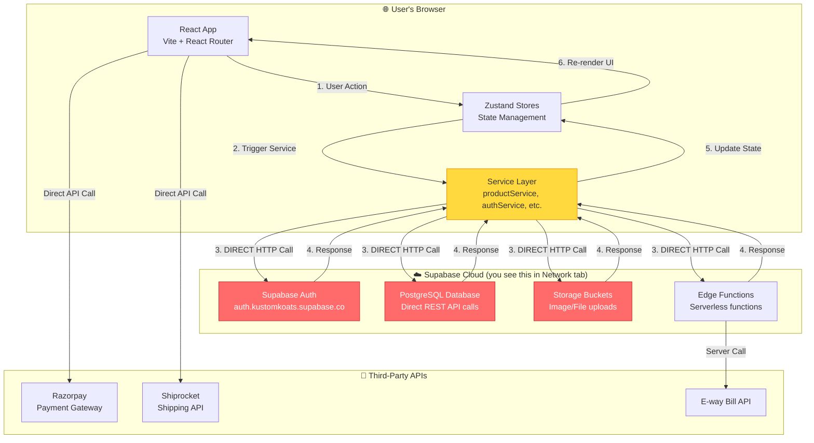
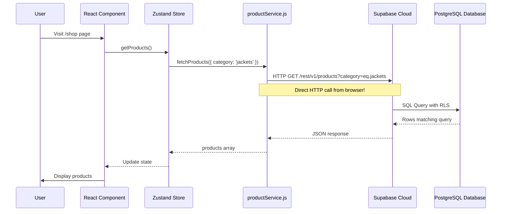
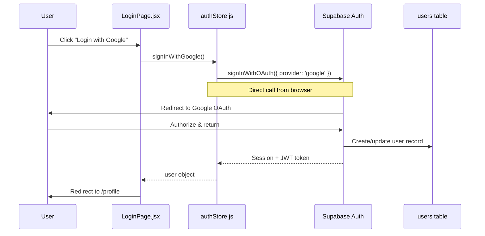
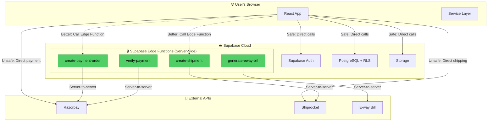

# Kustom Koats - ACTUAL Current Architecture

## ⚠️ THIS IS YOUR REAL ARCHITECTURE (What you see in Network Tab)

---

## Current Architecture: Direct Frontend-to-Supabase



---

## What You See in Network Tab

When you open DevTools > Network tab, you see requests like:

```
🌐 Network Requests:
├── kustomkoats.supabase.co/rest/v1/products?select=*
├── kustomkoats.supabase.co/auth/v1/token
├── kustomkoats.supabase.co/rest/v1/orders?user_id=eq.xxx
├── kustomkoats.supabase.co/storage/v1/object/public/products/...
└── razorpay.com/v1/checkout.js
```

**Why?** Because there's **NO traditional backend server**. Your React app talks **DIRECTLY** to Supabase.

---

## Architecture Explanation

### Layer 1: React Frontend (Browser)
```
📱 User clicks "Add to Cart"
  ↓
🎯 cartStore.addItem() called
  ↓
📦 productService.fetchProductById(id) called
  ↓
🌐 Supabase client makes HTTP request
```

### Layer 2: Supabase Client Library
```javascript
// src/lib/supabase.js
import { createClient } from "@supabase/supabase-js"

const supabaseUrl = import.meta.env.VITE_SUPABASE_URL  // https://xxx.supabase.co
const supabaseAnonKey = import.meta.env.VITE_SUPABASE_ANON_KEY  // public key

export const supabase = createClient(supabaseUrl, supabaseAnonKey)
```

**This client runs in the BROWSER** and makes **direct HTTP calls** to Supabase.

### Layer 3: Supabase Cloud (Backend-as-a-Service)
```
Supabase provides:
✅ PostgreSQL Database (with REST API auto-generated)
✅ Authentication (Google OAuth, Email/Password)
✅ File Storage
✅ Real-time subscriptions
✅ Row Level Security (RLS) policies
✅ Edge Functions (serverless)
```

---

## Data Flow Example: Fetching Products



---

## Data Flow Example: User Login



---

## Why Direct Calls Are Visible in Network Tab

### Traditional 3-Tier Architecture (NOT what you have):
```
Frontend → Your Backend Server → Database
  ↓           ↓                    ↓
Browser    Node/Express        PostgreSQL
```
In this model, you'd see calls to **your own API** (e.g., `yourdomain.com/api/products`)

### Your Current Architecture (Supabase BaaS):
```
Frontend → Supabase Cloud → Database
  ↓           ↓              ↓
Browser    REST API      PostgreSQL
```
You see calls to **Supabase URLs** directly because there's **no middle layer**.

---

## Security: How Is This Safe?

### Row Level Security (RLS)
Even though the database is "directly accessible," Supabase uses **Row Level Security**:

```sql
-- Example: Users can only see their own orders
CREATE POLICY "users_view_own_orders" ON orders
  FOR SELECT USING (auth.uid() = user_id);

-- Example: Only admins can update products
CREATE POLICY "admins_update_products" ON products
  FOR UPDATE USING (
    auth.jwt() ->> 'email' = 'admin@kustomkoats.com'
  );
```

**The JWT token** (in the `Authorization` header) determines:
- Who you are
- What you can access
- What operations you can perform

### What's Exposed vs Protected

| Item | Exposed? | Safe? |
|------|----------|-------|
| Supabase URL | ✅ Yes (in network tab) | ✅ Safe - it's meant to be public |
| Anon Key | ✅ Yes (in source code) | ✅ Safe - it's a public key |
| Database Structure | ✅ Yes (REST API endpoints) | ✅ Safe - RLS protects data |
| User JWT Token | ✅ Yes (in headers) | ✅ Safe - expires & is signed |
| Razorpay Key ID | ✅ Yes (VITE_RAZORPAY_KEY_ID) | ⚠️ SAFE - public key only |
| Razorpay Secret | ❌ No (should be backend only) | ⚠️ **RISK if exposed in frontend** |
| Shiprocket Email/Pass | ❌ No (should be backend only) | ⚠️ **RISK if exposed in frontend** |

---

## Current Issues (Security)

### 🔴 Critical Issue: Some Secrets May Be Exposed

```javascript
// ❌ BAD: If in .env with VITE_ prefix
VITE_RAZORPAY_KEY_SECRET=xxxxx  // This gets bundled into browser code!
VITE_SHIPROCKET_EMAIL=xxx
VITE_SHIPROCKET_PASSWORD=xxx

// ✅ GOOD: Without VITE_ prefix (only accessible on server/Edge Functions)
RAZORPAY_KEY_SECRET=xxxxx  // Safe - not exposed to browser
```

**Why VITE_ is Dangerous:**
- Vite embeds ALL `VITE_*` variables into the browser bundle
- Anyone can open DevTools > Sources and see them
- Attackers could use your credentials to make unauthorized API calls

---

## Proposed Improved Architecture



---

## Key Takeaways

### Current Architecture:
✅ **Supabase handles**: Database, Auth, Storage, RLS
✅ **React frontend**: Makes direct HTTP calls to Supabase
✅ **No traditional backend**: Supabase IS your backend
✅ **Network tab shows**: Direct calls to `*.supabase.co`

### Security Model:
✅ **Row Level Security**: Protects data at database level
✅ **JWT tokens**: Control access to resources
⚠️ **Exposed keys**: Some third-party API keys may be visible in browser

### Recommended Improvements:
1. Move Razorpay/Shiprocket calls to **Edge Functions**
2. Remove `VITE_*` prefix from **secret** credentials
3. Keep `VITE_*` prefix only for **public** keys (Supabase URL, Razorpay Key ID)
4. Add server-side validation for all payment/shipping operations
5. Implement webhook signature verification

---

## File Reference

### Where to look:
```
src/lib/supabase.js           → Supabase client initialization
src/services/*.js             → All services making direct Supabase calls
src/store/*.js                → Zustand stores managing state
src/pages/**/*.jsx            → React components
.env                          → Environment variables (check for VITE_*)
supabase/functions/           → Edge Functions (server-side code)
```

### Check Your .env File:
```bash
# Open this file and check:
c:\Users\saile\Desktop\huhu\KUSTOMKOATS\.env

# Look for dangerous patterns:
VITE_RAZORPAY_KEY_SECRET=      # ❌ Remove VITE_ prefix!
VITE_SHIPROCKET_PASSWORD=      # ❌ Remove VITE_ prefix!

# Safe patterns:
VITE_SUPABASE_URL=             # ✅ OK - public
VITE_SUPABASE_ANON_KEY=        # ✅ OK - public
VITE_RAZORPAY_KEY_ID=          # ✅ OK - public
RAZORPAY_KEY_SECRET=           # ✅ Good - not exposed
```

---

**This is your REAL architecture.** The diagrams in the previous document were for the *documentation generation tool*, not your actual e-commerce platform.
