# Database Entity-Relationship Diagram

## KUSTOMKOATS E-Commerce Database Schema

This document contains the complete Entity-Relationship diagram for the KUSTOMKOATS database, generated from migration files.

---

## Complete ER Diagram

```mermaid
erDiagram
    %% Core E-Commerce Tables
    
    products {
        uuid id PK
        text name
        numeric price
        text category
        text description
        text_array images
        text_array tags
        integer stock
        text size
        timestamptz created_at
        text sku
        text brand
        text colour
        text finish
        text gtin_ean
        text internal_barcode
        text barcode_type
        numeric mrp
        text status
        text tech_details_title
        text tech_details_description
        text custom_id
        numeric original_price
        numeric delivery_charge
        numeric wholesale_price
        numeric dealer_price
        text display_product_id
        text hsn_code
    }
    
    users {
        uuid id PK
        text email
        timestamptz created_at
    }
    
    profiles {
        uuid id PK
        text email
        text role
    }
    
    cart {
        uuid id PK
        uuid user_id FK
        uuid product_id FK
        integer quantity
        timestamptz created_at
    }
    
    orders {
        uuid id PK
        uuid user_id FK
        numeric total_amount
        text payment_status
        text address
        text razorpay_payment_id
        text razorpay_order_id
        text razorpay_signature
        timestamptz created_at
        text guest_email
        text guest_name
        text guest_phone
        text payment_method
        text order_status
        text order_notes
        text city
        text state
        text pincode
        text order_type
        text eway_bill_no
        timestamptz eway_bill_date
        text display_order_id
    }
    
    order_items {
        uuid id PK
        uuid order_id FK
        uuid product_id FK
        integer quantity
        numeric price
    }
    
    wishlist {
        uuid id PK
        uuid user_id FK
        uuid product_id FK
        timestamptz created_at
    }
    
    %% Product Technical Details
    
    product_technical_bars {
        uuid id PK
        uuid product_id FK
        text title
        text_array labels
        text selected_value
        integer sort_order
        timestamptz created_at
    }
    
    product_specifications {
        uuid id PK
        uuid product_id FK
        text spec_name
        text spec_value
        integer sort_order
        timestamptz created_at
    }
    
    %% Bundles/Kits System
    
    bundles {
        uuid id PK
        text name
        text description
        text image_url
        numeric bundle_price
        numeric original_price
        numeric savings_amount
        numeric savings_percentage
        boolean is_active
        integer display_order
        timestamptz created_at
        timestamptz updated_at
    }
    
    bundle_items {
        uuid id PK
        uuid bundle_id FK
        uuid product_id FK
        integer quantity
        timestamptz created_at
    }
    
    product_bundle_relations {
        uuid id PK
        uuid product_id FK
        uuid bundle_id FK
        integer display_order
        timestamptz created_at
    }
    
    %% Promo Codes System
    
    promo_codes {
        uuid id PK
        text code UK
        text discount_type
        numeric discount_value
        numeric min_order_amount
        text applicable_category
        boolean is_one_time
        integer max_uses
        timestamptz expires_at
        boolean is_active
        text description
        timestamptz created_at
        timestamptz updated_at
    }
    
    promo_code_uses {
        uuid id PK
        uuid code_id FK
        uuid user_id FK
        uuid order_id FK
        timestamptz used_at
    }
    
    %% Wholesale System
    
    wholesale_applications {
        uuid id PK
        text full_name
        text email
        text phone
        text business_name
        text application_type
        text city
        text state
        text pincode
        text place_location
        text address
        text message
        text status
        text admin_notes
        timestamptz created_at
        timestamptz updated_at
    }
    
    %% Categories
    
    categories {
        uuid id PK
        text name UK
        text slug
        text description
        text image_url
        integer sort_order
        boolean is_active
        timestamptz created_at
    }
    
    %% CMS Tables
    
    faqs {
        uuid id PK
        text category
        text question
        text answer
        integer sort_order
        boolean is_published
        timestamptz created_at
        timestamptz updated_at
    }
    
    footer_links {
        uuid id PK
        text section
        text label
        text url
        integer sort_order
        boolean is_active
        timestamptz created_at
        timestamptz updated_at
    }
    
    site_pages_content {
        uuid id PK
        text page_key UK
        text hero_title
        text hero_subtitle
        jsonb sections
        timestamptz updated_at
    }
    
    testimonials {
        uuid id PK
        text name
        text review
        integer rating
        text role
        text image_url
        boolean is_approved
        boolean is_active
        integer display_order
        timestamptz created_at
        timestamptz updated_at
    }
    
    %% Blog System
    
    blog_posts {
        uuid id PK
        text title
        text slug UK
        text excerpt
        text content
        text featured_image
        text category
        uuid author_id FK
        text author_name
        boolean published
        boolean featured
        integer views
        integer likes
        timestamptz created_at
        timestamptz updated_at
        timestamptz published_at
    }
    
    blog_categories {
        uuid id PK
        text name UK
        text slug UK
        text description
        text color
        timestamptz created_at
    }
    
    %% Admin & Notifications
    
    admin_notifications {
        uuid id PK
        text type
        text title
        text message
        uuid order_id FK
        jsonb metadata
        boolean is_read
        timestamptz created_at
        timestamptz read_at
    }
    
    %% E-Way Bill System
    
    eway_bill_config {
        uuid id PK
        text seller_gstin
        text seller_trade_name
        text seller_address_1
        text seller_address_2
        text seller_place
        text seller_pincode
        integer seller_state_code
        text api_username
        text api_password
        text default_hsn_code
        decimal cgst_rate
        decimal sgst_rate
        text transporter_id
        text transporter_name
        text trans_mode
        boolean is_active
        timestamptz created_at
        timestamptz updated_at
    }
    
    eway_bills {
        uuid id PK
        uuid order_id FK
        text ewb_no UK
        timestamptz ewb_date
        timestamptz valid_upto
        text doc_type
        text doc_no
        date doc_date
        text from_gstin
        text from_trade_name
        text to_gstin
        text to_trade_name
        text transporter_id
        text transporter_name
        text vehicle_no
        text trans_doc_no
        text trans_mode
        decimal total_value
        decimal cgst_value
        decimal sgst_value
        decimal igst_value
        decimal total_inv_value
        text status
        timestamptz cancel_date
        text cancel_reason
        jsonb api_response
        timestamptz created_at
        timestamptz updated_at
    }
    
    eway_bill_requests {
        bigint id PK
        bigint request_id UK
        text action
        text status
        jsonb response
        text error
        uuid created_by FK
        timestamptz created_at
        timestamptz updated_at
    }
    
    %% Payment Failures Tracking
    
    payment_failures {
        uuid id PK
        uuid order_id FK
        text razorpay_order_id
        text razorpay_payment_id
        uuid user_id FK
        text customer_email
        text customer_phone
        text customer_name
        text error_code
        text error_description
        text error_source
        text error_step
        text error_reason
        text payment_method
        numeric amount
        text currency
        jsonb metadata
        text customer_ip
        text user_agent
        timestamptz failed_at
        timestamptz created_at
        boolean reviewed
        uuid reviewed_by FK
        timestamptz reviewed_at
        text admin_notes
    }
    
    %% Stock History
    
    stock_history {
        uuid id PK
        uuid product_id FK
        integer old_stock
        integer new_stock
        uuid changed_by FK
        text reason
        timestamptz created_at
    }
    
    %% Site Settings
    
    site_settings {
        text key PK
        text value
        timestamptz updated_at
    }
    
    %% Contact & Enquiry Forms
    
    contact_submissions {
        uuid id PK
        text name
        text email
        text phone
        text subject
        text message
        text status
        timestamptz created_at
        timestamptz updated_at
    }
    
    enquiry_submissions {
        uuid id PK
        text name
        text email
        text phone
        uuid product_id FK
        text message
        text status
        timestamptz created_at
        timestamptz updated_at
    }
    
    %% Relationships
    
    users ||--o{ cart : "has"
    users ||--o{ orders : "places"
    users ||--o{ wishlist : "has"
    users ||--o{ blog_posts : "authors"
    users ||--o{ eway_bill_requests : "creates"
    users ||--o{ stock_history : "changes"
    
    profiles ||--o{ payment_failures : "experiences"
    profiles ||--o{ payment_failures : "reviews"
    
    products ||--o{ cart : "in"
    products ||--o{ order_items : "ordered"
    products ||--o{ wishlist : "wishlisted"
    products ||--o{ product_technical_bars : "has"
    products ||--o{ product_specifications : "has"
    products ||--o{ bundle_items : "included_in"
    products ||--o{ product_bundle_relations : "relates_to"
    products ||--o{ stock_history : "tracked"
    products ||--o{ enquiry_submissions : "enquired_about"
    
    orders ||--|{ order_items : "contains"
    orders ||--o| admin_notifications : "triggers"
    orders ||--o| eway_bills : "has"
    orders ||--o{ payment_failures : "failed"
    
    bundles ||--o{ bundle_items : "contains"
    bundles ||--o{ product_bundle_relations : "related_to"
    
    promo_codes ||--o{ promo_code_uses : "used_in"
    promo_code_uses }o--|| users : "used_by"
    promo_code_uses }o--|| orders : "applied_to"
```

---

## Table Categories

### 🛒 **Core E-Commerce**
- `products` - Main product catalog
- `cart` - Shopping cart items
- `orders` - Customer orders
- `order_items` - Individual items in orders
- `wishlist` - Customer wishlists

### 👤 **Authentication & Users**
- `users` - Supabase auth users
- `profiles` - Extended user profiles

### 📦 **Product Details**
- `product_technical_bars` - Interactive technical sliders
- `product_specifications` - Product specifications
- `categories` - Product categories

### 🎁 **Bundles & Promotions**
- `bundles` - Product bundle/kit definitions
- `bundle_items` - Products in bundles
- `product_bundle_relations` - Product-to-bundle relationships
- `promo_codes` - Promotional discount codes
- `promo_code_uses` - Promo code usage tracking

### 🏪 **Wholesale**
- `wholesale_applications` - Dealer/distributor applications

### 📝 **Content Management**
- `faqs` - FAQ entries
- `footer_links` - Footer navigation links
- `site_pages_content` - CMS pages (About, Why Partner, etc.)
- `testimonials` - Customer testimonials
- `blog_posts` - Blog articles
- `blog_categories` - Blog category taxonomy

### 🔔 **Admin & Notifications**
- `admin_notifications` - Admin panel notifications
- `stock_history` - Product stock change audit log
- `site_settings` - Global site configuration

### 💰 **Payment & Billing**
- `payment_failures` - Failed payment tracking
- `eway_bill_config` - E-Way Bill configuration
- `eway_bills` - Generated E-Way Bills
- `eway_bill_requests` - E-Way Bill API requests (async)

### 📧 **Customer Communication**
- `contact_submissions` - Contact form submissions
- `enquiry_submissions` - Product enquiry submissions

---

## Key Features

### 🔐 **Row Level Security (RLS)**
All tables have RLS enabled with appropriate policies for:
- Public read access (products, testimonials, blog posts)
- User-specific access (cart, orders, wishlist)
- Admin-only access (admin_notifications, wholesale_applications)

### 🔄 **Auto-updated Fields**
Tables with automatic `updated_at` timestamps:
- `products`, `orders`, `bundles`, `promo_codes`
- `testimonials`, `blog_posts`, `faqs`, `footer_links`
- `wholesale_applications`, `site_pages_content`

### 🔢 **Auto-increment Product IDs**
- Display Product ID format: `KK-100001`
- Managed via `site_settings` table
- Automatically generated on product insert

### 📊 **Audit Trails**
- `stock_history` - Tracks all inventory changes
- `promo_code_uses` - Tracks promo code usage
- `payment_failures` - Tracks all payment issues

### 🚚 **E-Way Bill Integration**
- Configuration storage
- Bill generation tracking
- Async API request handling via pg_net

---

## Database Statistics

- **Total Tables**: 35+
- **Primary Keys**: All use UUID (gen_random_uuid())
- **Foreign Key Relationships**: 40+
- **Indexes**: 50+ for optimized queries
- **Triggers**: 10+ for auto-updates and notifications

---

## Migration History

All migrations are located in `database/migrations/migration001.sql` through `migration035.sql`

Key migration milestones:
- **001-005**: Product inventory & E-Way Bill setup
- **006-016**: Wholesale, RLS policies, technical details
- **017-021**: CMS (FAQs, Footer, Blog, POS)
- **022-025**: Bundles, promo codes, settings
- **026-030**: Core e-commerce tables
- **031-035**: Blog storage, technical bars, testimonials, payment tracking, contact forms

---

Generated: 2026-11-05
Schema Version: 35
