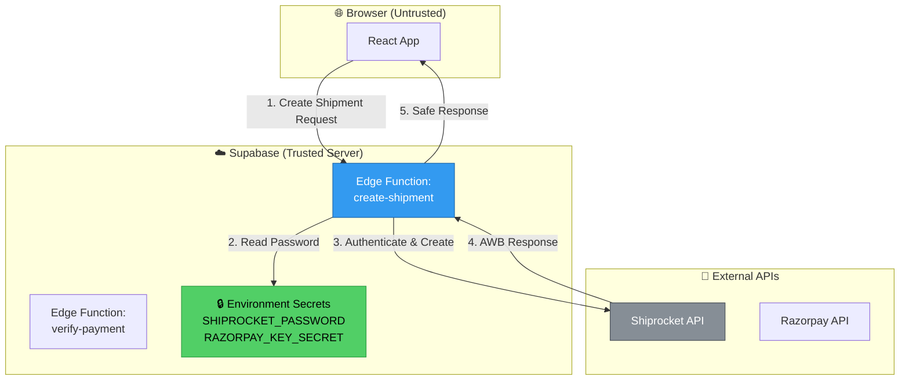

# 🚨 CRITICAL SECURITY ALERT

## ⚠️ EXPOSED CREDENTIALS DETECTED IN YOUR .ENV FILE

---

## 🔴 IMMEDIATE ACTION REQUIRED

Your `.env` file contains **SHIPROCKET PASSWORD** with the `VITE_` prefix, which means it's **EXPOSED IN YOUR BROWSER BUNDLE**.

### What's Exposed:

```env
# ❌ CRITICAL: These are visible in browser DevTools!
VITE_SHIPROCKET_EMAIL=kustomkoats.business@gmail.com
VITE_SHIPROCKET_PASSWORD=S5LXM#3@87^WnEbwVMuL9IvY2pCVyLy@
```

---

## Why This Is Dangerous

### How VITE_ Environment Variables Work:

1. **Build Time**: When you run `npm run build`, Vite scans for all `VITE_*` variables
2. **Bundling**: These values are **hard-coded** into your JavaScript bundle
3. **Browser Access**: Anyone can open DevTools > Sources and search for them
4. **Result**: Your Shiprocket credentials are **publicly visible** to anyone who visits your website

### Proof:
```bash
# Anyone can do this:
1. Visit https://www.kustomkoats.com
2. Open DevTools (F12)
3. Go to Sources tab
4. Search for "SHIPROCKET" in the bundle
5. Find your email and password in plain text
```

---

## What Can Attackers Do?

With exposed Shiprocket credentials, an attacker could:

1. ✅ **Create fake shipments** under your account
2. ✅ **Cancel real customer shipments**
3. ✅ **Access customer shipping addresses**
4. ✅ **Exhaust your Shiprocket API quota**
5. ✅ **Modify shipment details**
6. ✅ **Generate fraudulent AWB numbers**
7. ✅ **Access your shipping transaction history**

---

## Immediate Fix Steps

### Step 1: Remove VITE_ Prefix from Secrets

**Edit `.env` file:**

```diff
# ❌ BEFORE (EXPOSED)
- VITE_SHIPROCKET_EMAIL=kustomkoats.business@gmail.com
- VITE_SHIPROCKET_PASSWORD=S5LXM#3@87^WnEbwVMuL9IvY2pCVyLy@

# ✅ AFTER (SAFE - Backend only)
+ SHIPROCKET_EMAIL=kustomkoats.business@gmail.com
+ SHIPROCKET_PASSWORD=S5LXM#3@87^WnEbwVMuL9IvY2pCVyLy@
```

### Step 2: Move Shiprocket Calls to Edge Functions

Create a Supabase Edge Function to handle Shiprocket operations:

**Create**: `supabase/functions/create-shipment/index.ts`

```typescript
import { serve } from "https://deno.land/std@0.168.0/http/server.ts"

serve(async (req) => {
  try {
    // Get Shiprocket credentials from environment (NOT exposed to browser)
    const email = Deno.env.get('SHIPROCKET_EMAIL')
    const password = Deno.env.get('SHIPROCKET_PASSWORD')
    
    // 1. Authenticate with Shiprocket
    const authResponse = await fetch('https://apiv2.shiprocket.in/v1/external/auth/login', {
      method: 'POST',
      headers: { 'Content-Type': 'application/json' },
      body: JSON.stringify({ email, password })
    })
    
    const { token } = await authResponse.json()
    
    // 2. Get shipment data from request
    const shipmentData = await req.json()
    
    // 3. Create shipment with Shiprocket
    const createResponse = await fetch('https://apiv2.shiprocket.in/v1/external/orders/create/adhoc', {
      method: 'POST',
      headers: {
        'Content-Type': 'application/json',
        'Authorization': `Bearer ${token}`
      },
      body: JSON.stringify(shipmentData)
    })
    
    const result = await createResponse.json()
    
    return new Response(JSON.stringify(result), {
      headers: { 'Content-Type': 'application/json' }
    })
    
  } catch (error) {
    return new Response(JSON.stringify({ error: error.message }), {
      status: 500,
      headers: { 'Content-Type': 'application/json' }
    })
  }
})
```

### Step 3: Update Frontend Code

**Replace** direct Shiprocket calls with Edge Function calls:

**Before (INSECURE):**
```javascript
// src/services/shiprocketService.js
const email = import.meta.env.VITE_SHIPROCKET_EMAIL  // ❌ Exposed!
const password = import.meta.env.VITE_SHIPROCKET_PASSWORD  // ❌ Exposed!

// Direct call from browser
const response = await fetch('https://apiv2.shiprocket.in/v1/external/auth/login', {
  method: 'POST',
  body: JSON.stringify({ email, password })
})
```

**After (SECURE):**
```javascript
// src/services/shiprocketService.js
import { supabase } from '../lib/supabase'

// Call Edge Function instead (credentials stay on server)
const { data, error } = await supabase.functions.invoke('create-shipment', {
  body: { 
    order_id: orderId, 
    shipping_address: address,
    // ... other shipment data
  }
})
```

### Step 4: Deploy Edge Function

```bash
# Set the secret in Supabase Dashboard (NOT in .env)
supabase secrets set SHIPROCKET_EMAIL=kustomkoats.business@gmail.com
supabase secrets set SHIPROCKET_PASSWORD=S5LXM#3@87^WnEbwVMuL9IvY2pCVyLy@

# Deploy the Edge Function
supabase functions deploy create-shipment
```

### Step 5: Verify Fix

1. **Build your app**: `npm run build`
2. **Search bundle**: Look for "SHIPROCKET" in `dist/` folder
3. **Expected result**: Should NOT find email/password
4. **Network tab**: Should see calls to `/functions/v1/create-shipment` instead of `shiprocket.in`

---

## Other Security Concerns

### ✅ SAFE (These CAN have VITE_ prefix):

```env
VITE_SUPABASE_URL=https://gozoxlueuwnyujvvafdl.supabase.co
# ✅ Safe - This is meant to be public

VITE_SUPABASE_ANON_KEY=eyJhbGci...
# ✅ Safe - This is a PUBLIC anonymous key (RLS protects data)

VITE_RAZORPAY_KEY_ID=rzp_live_Tm8zdwG0mHgj7d
# ✅ Safe - This is the PUBLIC key (not the secret)

VITE_ADMIN_EMAIL=sailendrakondapalli@gmail.com
# ⚠️ Acceptable - Just an email, but consider moving admin checks to server
```

### ❓ MISSING: Razorpay Secret Key

I notice you only have `VITE_RAZORPAY_KEY_ID`. Where is your **Razorpay Key Secret**?

**Check if it's in any of these places:**
1. `supabase/.env` (Edge Functions environment)
2. Supabase Dashboard > Project Settings > Edge Functions > Secrets
3. Hardcoded in source files (even worse!)

**If not set up yet**, you MUST:
1. Store `RAZORPAY_KEY_SECRET` in Supabase secrets (NOT with VITE_ prefix)
2. Use Edge Functions for payment verification
3. NEVER verify payment signatures in browser code

---

## Complete Security Checklist

| Item | Current Status | Action Needed |
|------|----------------|---------------|
| Shiprocket Email | 🔴 **EXPOSED** | Remove `VITE_` prefix + use Edge Function |
| Shiprocket Password | 🔴 **EXPOSED** | Remove `VITE_` prefix + use Edge Function |
| Razorpay Key ID | ✅ Safe | No action (public key) |
| Razorpay Key Secret | ❓ Unknown | Verify it's NOT exposed, use Edge Function |
| Supabase URL | ✅ Safe | No action (public URL) |
| Supabase Anon Key | ✅ Safe | No action (public key) |
| Admin Email Check | ⚠️ Client-side only | Move admin verification to Edge Function |

---

## Architecture After Fix



---

## Priority Actions (In Order)

### 🔴 URGENT (Do Today):

1. **Change Shiprocket Password** (current one may already be compromised)
   - Login to https://app.shiprocket.in/
   - Go to Settings > Change Password
   - Use a NEW strong password

2. **Remove VITE_ prefix from secrets** in `.env`

3. **Commit .env changes** (if you track it) or deploy new environment

### ⚠️ HIGH (Do This Week):

4. **Create Shiprocket Edge Function** (as shown above)

5. **Update frontend to use Edge Function** instead of direct API calls

6. **Verify Razorpay secret** is not exposed

7. **Create Payment Verification Edge Function** if not exists

### ✅ MEDIUM (Do This Month):

8. Add server-side admin role verification

9. Implement webhook signature verification

10. Add rate limiting on Edge Functions

11. Set up monitoring/alerting for API abuse

---

## Need Help?

If you need assistance implementing these fixes:

1. **Supabase Edge Functions Docs**: https://supabase.com/docs/guides/functions
2. **Setting Secrets**: https://supabase.com/docs/guides/functions/secrets
3. **Shiprocket API Docs**: https://apidocs.shiprocket.in/

---

**⚠️ DO NOT IGNORE THIS WARNING**

Exposed API credentials are a **critical security vulnerability**. Attackers actively scan for these patterns. Fix this before promoting your site.
